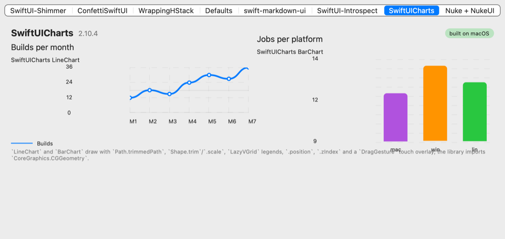
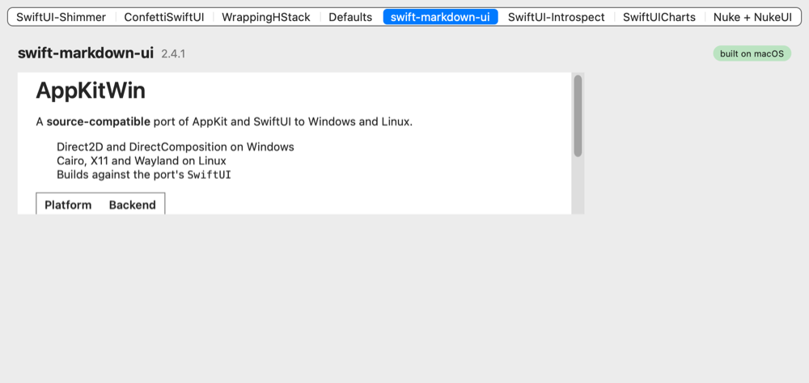

# Third-party SwiftUI libraries on AppKitWin

How eight popular open-source SwiftUI packages fare when built against this package's
`SwiftUI` instead of Apple's, measured by `Examples/LibraryCompat` (one tab per library)
and `tools/library-compat.sh --probe` (each library built on its own, first error
recorded). The point of the exercise is the last section: the concrete API gaps the
libraries ran into, which are the port's to-do list for library compatibility.

"macOS" below means the macOS host build compiling the library against AppKitWin's
SwiftUI (the script raises every deployment target to 14.0 so the compiler accepts the
mix), not Apple's SwiftUI, where all of them build by definition. Results as of
2026-11-04, Swift 6.2 on macOS and in the Linux container, Swift 6.2/6.4 on Windows.

## Verdicts

| Library | Version | Builds: macOS / Windows / Linux | Runs | What is wrong |
| --- | --- | --- | --- | --- |
| [SwiftUI-Shimmer](https://github.com/markiv/SwiftUI-Shimmer) | 1.5.1 | yes / yes / yes | yes | The band animates over the masked content on Windows, Linux and macOS (4.5 % of a 12-core Windows machine while it runs) (`.mask` of an animated `LinearGradient`); the `.overlay(blendMode:)` mode draws the gradient over the text because compositing blend modes are not applied yet. |
| [ConfettiSwiftUI](https://github.com/simibac/ConfettiSwiftUI) | 3.0.0 | yes / yes / yes | yes | Confetti bursts, falls, spins (`.rotation3DEffect`) and fades on Windows and Linux (Linux screenshot below; the macOS host is headless and its capture only shows the counter). Haptics are `#if canImport(UIKit)` and skipped. |
| [SwiftUICharts](https://github.com/willdale/SwiftUICharts) | 2.10.4 | yes / no / no | yes (macOS) | Line and bar charts with grids, axis labels, point markers, legends and the touch overlay (macOS screenshot below). On Windows and Linux every file compiles, including the `import CoreGraphics.CGGeometry` submodule import, except one: `Color.systemsBackground` switches on `os(iOS)`/`watchOS`/`tvOS`/`macOS`/`visionOS` with no default and so has no return (SwiftUICharts/Shared/Extras/Extensions.swift:136, 9 errors). Needs an upstream `#else`. On Windows the Swift 6.4.1 frontend first asserts on several of its shape files (debug-type round trip, DoughnutSegmentShape.swift among them); the probe passes `-disable-round-trip-debug-types` there to get past it. |
| [swift-markdown-ui](https://github.com/gonzalezreal/swift-markdown-ui) | 2.4.1 | yes / no / no | yes (macOS) | Headings, emphasis, lists, tables and block quotes render (macOS screenshot below); list bullets are `Image(systemName:)` SF Symbols, which have no glyphs here. On Windows and Linux its `NetworkImage` dependency extends `URLSession` in a file that imports only `Foundation` (NetworkImage/Sources/NetworkImage/URLSession+NetworkImage.swift:1), and on swift-corelibs-foundation that `URLSession` is a placeholder for `FoundationNetworking`'s; the port's re-export cannot reach a file that imports nothing of it. Needs an upstream `#if canImport(FoundationNetworking)`. |
| [WrappingHStack](https://github.com/dkk/WrappingHStack) | 2.2.11 | yes / no / no | yes (macOS) | `#if os(macOS)` … `#else UIHostingController`: on Windows and Linux the first error is `cannot find 'UIHostingController' in scope` (WrappingHStack/Sources/WrappingHStack/WrappingHStack.swift:78). Needs an upstream `canImport(AppKit)` check. On macOS the tag cloud wraps correctly. |
| [Defaults](https://github.com/sindresorhus/Defaults) | 9.0.9 | yes / no / no | yes (macOS) | Same `#if os(macOS)` / `#else import UIKit` (Defaults/Sources/Defaults/Defaults+Bridge.swift:5). The macOS build stores and reads keys through `@Default` and `Defaults.Toggle`; on Windows and Linux it would also meet corelibs Foundation without KVO on `UserDefaults`. |
| [SwiftUI-Introspect](https://github.com/siteline/swiftui-introspect) | 27.1.0 | no / no / no | — | Linux and Windows: `no such module 'ObjectiveC'` (swiftui-introspect/Sources/IntrospectionView.swift:214), then `NSView.subviews` walks of Apple's private hierarchy. macOS host build: the SDK's MapKit/WebKit/AVKit view types fail `PlatformEntity` (Map.swift:107) and its views are not main-actor isolated. By design it reaches into AppKit internals; not a target for the port. |
| [Nuke + NukeUI](https://github.com/kean/Nuke) | 13.2.1 | no / no / no | — | Windows and Linux: `#if !os(macOS) import UIKit` (Nuke/Sources/Nuke/Caching/ImageCache.swift:7). macOS: `CIImage`/`CIFilter` (no Core Image), the ImageIO C API (`CGImageSourceCreateWithData`, `kCGImageSourceShouldCache`, `CGImagePropertyOrientation`: the port has `CGImageSource` as a class, not the C functions), `NSImage`/`NSColor` not `Sendable`. Blocked upstream first, so the macOS gaps are not closed. |

Shimmer on Linux (X11 under Xvfb) and macOS, confetti on Linux, the tag cloud, Defaults,
SwiftUICharts and swift-markdown-ui on macOS (`LibraryCompat --screenshot`, `tools/linux/run.sh`):

<table>
  <tr>
    <td></td>
    <td></td>
  </tr>
  <tr>
    <td></td>
    <td></td>
  </tr>
  <tr>
    <td></td>
    <td></td>
  </tr>
</table>

Linux (the `appkitwin-linux` container, Swift 6.2): 308 host-backend tests pass, the probe
gives the verdicts above (SwiftUICharts' 9 errors are all the one getter, MarkdownUI's 9 are
all NetworkImage's `URLSession`), and `LibraryCompat --screenshot` under Xvfb captures all
eight tabs, the six excluded ones showing their reason. Windows (Swift 6.4.1, 150 % DPI): the root build
and 306 host-backend tests pass, the probe gives the same verdicts except SwiftUICharts'
frontend assertion, and `--screenshot` captures all eight tabs; the PC run is recorded in
the pull request.

## How the example is built

The third-party packages do not depend on AppKitWin, so three things are needed before
`import SwiftUI` in one of them resolves to the port (all in `tools/library-compat.sh`):

1. AppKitWin's `SwiftUI` (and on Windows and Linux `ImageIO`) must already be in the
   build's `Modules` directory: `swift build --target SwiftUI`, then `swift build`.
2. Every compile gets the C shim module maps (`-Xcc -fmodule-map-file=…` for `CCairo`,
   `CD2D`, …) and on Linux the pkg-config include paths, because a client of `AppKit`
   needs the clang modules it imports and SwiftPM passes them only to declared dependents.
3. On macOS every target's deployment target is raised to 14.0 (the libraries declare
   10.15–12, the host build's modules 14).

A library that fails to build stays declared in `Examples/LibraryCompat/Package.swift` so
the probe can re-check it; only the ones that compile are linked into the app on each
platform, and the app shows the exclusion reason on the library's tab.

## Fixed in the port for this example

Each with a test in `Tests/AppKitTests/SwiftUIEffectsTests.swift` unless noted:

- `Gradient`, `Gradient.Stop`, `LinearGradient` as a `View` and a `ShapeStyle`
  (`Shape.fill(_ style:)`), drawn as bands since CoreGraphics on Windows and Linux has no
  `CGGradient`; the end points animate under `.animation(_:value:)` (Shimmer).
- `.mask(_:)` and `.mask(alignment:_:)`: the mask hierarchy is rendered offscreen into the
  backing layer's mask (Shimmer).
- `PreferenceKey`, `.preference`, `.anchorPreference`, `.transformPreference`,
  `.onPreferenceChange`, `Anchor.Source` (`.bounds`, `.rect`, `.point`, `.unitPoint`, …)
  resolved after layout and converted by `GeometryProxy[anchor]`; delivered inside the
  layout pass so a `frame(height:)` fed by a preference settles in one pass (WrappingHStack).
- `.rotation3DEffect(_:axis:anchor:anchorZ:perspective:)` on the layer's 3D transform,
  animatable (ConfettiSwiftUI).
- `.task` and `.task(id:)`, `.redacted(reason:)`/`.unredacted()`/`RedactionReasons`,
  `Image(_:scale:orientation:label:)` and `Image(decorative:scale:orientation:)` from a
  `CGImage`, `NSImage()` (NetworkImage).
- `Color(cgColor:)`, `Color(_ cgColor:)`, `Color(_ nsColor:)`, `Color.cgColor`,
  `Color.Resolved` with `resolve(in:)`, `NSColor(_ color: Color)`, `Label` with
  `StringProtocol` titles (Defaults).
- `View`, `ObservedObject`, `StateObject` and `PreviewProvider` are main-actor isolated as
  Apple's are, so `@StateObject private var model = MainActorModel()` and `static var
  previews` compile (NetworkImage, every library's `#if DEBUG` previews); `PreviewProvider`,
  `PreviewLayout`, `.previewLayout`, `.previewDisplayName`.
- `.blendMode(_:)` and `BlendMode`: accepted and set as the layer's compositing filter, which
  the compositors do not apply yet (Shimmer's overlay mode draws the gradient opaque).
- `Text` never breaks inside a word: a proposal narrower than its widest word is answered
  with that word's width, as SwiftUI does, so stacks with spacers no longer squeeze tags
  into columns of letters (WrappingHStack; `SwiftUILibraryIdiomTests`).
- Custom `DynamicProperty` wrappers have their own dynamic properties installed (a wrapper
  around `@ObservedObject` such as Defaults' `@Default` now refreshes the view).

For SwiftUICharts (`Tests/AppKitTests/SwiftUIShapeAndGridTests.swift`):

- `import CoreGraphics.CGGeometry` on Windows and Linux: `Sources/CCoreGraphicsModules` is a
  clang module map declaring Apple's CoreGraphics submodule names with no headers; the
  port's Swift `CoreGraphics` module is treated as that clang module's overlay, so a
  submodule import resolves to the Swift declarations. The port's `CoreGraphics` also
  re-exports `Foundation` (which defines `CGFloat` on corelibs) and `FoundationNetworking`.
- `InsettableShape` with `strokeBorder`, `inset(by:)` on the built-in shapes;
  `ScaledShape`/`RotatedShape`/`OffsetShape`/`TransformedShape` and `Shape.scale`/`rotation`/
  `offset`/`transform`/`trim`; `Path.Element`, `forEach`, `currentPoint`, `applying`,
  `offsetBy`, `addRelativeArc`, `addArc(tangent1End:…)`, `trimmedPath(from:to:)` (curves cut
  exactly); `Shape` is `Sendable` with a nonisolated `path(in:)` as Apple's.
- `Shape.fill`/`stroke` with any `ShapeStyle` and a full `StrokeStyle` (caps, joins, dashes);
  a gradient stroke is drawn segment by segment with the gradient's colour along the line.
- `GridItem`, `LazyVGrid`, `LazyHGrid`, `PinnedScrollableViews`; `.position`, `.zIndex`
  (siblings' backing views are ordered by it), `.accessibilityElement(children:)`, the
  value-less `.animation(_:)`, `LocalizedStringKey.StringInterpolation` with `specifier:`,
  formatters and format styles.
- Node measurements are memoised per layout pass: nested stacks probe each item with three
  proposals, and SwiftUICharts' hierarchy made that exponential (the chart tab hung).

For swift-markdown-ui (`Tests/AppKitTests/SwiftUILayoutProtocolTests.swift`):

- The `Layout` protocol: `LayoutSubview`/`LayoutSubviews`, `ViewSpacing`, `LayoutValueKey`,
  `callAsFunction` over the content's layout leaves; unplaced subviews are centred.
- `AlignmentID` with `HorizontalAlignment(_:)`/`VerticalAlignment(_:)` and `ViewDimensions`:
  stacks now align the items' guides on one line, which also makes `firstTextBaseline` and
  `lastTextBaseline` real (from the text's font metrics) instead of bottom alignment.
- `Grid`, `GridRow`, `.gridColumnAlignment`, `.gridCellColumns` (columns sized by their
  widest cell, a non-row child spans the grid).
- `LabelStyle` with `LabelStyleConfiguration` and the built-in styles; `Label` builds its
  body from the environment's style.
- `AttributeScopes.SwiftUIAttributes` (`font`, `foregroundColor`, `backgroundColor`,
  `underlineStyle`, `strikethroughStyle`, `kern`, `tracking`, `baselineOffset`) and
  `Text(AttributedString)` honouring them plus Foundation's inline presentation intents.
- `Font.Width`/`width(_:)`, `smallCaps` family, `leading`, `Text.LineStyle` with patterned
  `underline`/`strikethrough`, `Text.monospacedDigit`/`tracking`/`monospaced`, `Text(Image)`
  (the image's label stands in; the text system has no attachments yet),
  `Image(_:bundle:label:)`, `.symbolRenderingMode`, `.imageScale`, `.lineSpacing`,
  `AnyShapeStyle`, `@ScaledMetric` (Dynamic Type has no counterpart; the value is used as
  given), `.transformEnvironment`, `.backgroundPreferenceValue`/`.overlayPreferenceValue`,
  `foregroundStyle(_:_:)`/`(_:_:_:)` (only the primary style applies).
- `NSFontManager.shared` with `convert(_:toHaveTrait:)`, `traits(of:)` and `weight(of:)` over
  `NSFont` (`Font.italic()` had been calling a stub); the hand-written class replaces the
  generated one.
- Flexible frames follow SwiftUI's rule that a missing bound defaults to the content's size:
  `.frame(minWidth:)` no longer stretches to the proposal (MarkdownUI's list markers).

## API gaps found (not fixed)

Listed in `docs/ROADMAP.md` as follow-ups:

- Blocked upstream, not by the port (file and line in the table): SwiftUICharts'
  `Color.systemsBackground` switch, NetworkImage's `Foundation`-only `URLSession` extension,
  WrappingHStack's and Defaults' `#if os(macOS)`/`#else` UIKit branches, Nuke's
  `#if !os(macOS) import UIKit`, SwiftUI-Introspect's `ObjectiveC` import and private-hierarchy
  walks. No UIKit or ObjectiveC module is faked for them.
- Nuke on the macOS host build: Core Image (`CIImage`, `CIFilter`) has no counterpart; the
  ImageIO C API (`CGImageSourceCreateWithData`, `CGImageSourceCreateThumbnailAtIndex`,
  `CGImageSourceCopyPropertiesAtIndex`, `kCGImageSource…`/`kCGImageProperty…` keys,
  `CGImagePropertyOrientation`) is not exposed (the port has the `CGImageSource` class);
  `NSImage` and `NSColor` are not `Sendable`. Left as is while the library is UIKit-blocked
  on the platforms the port targets.
- Rendering: `Image(systemName:)` has no SF Symbol glyphs (markdown list bullets are blank);
  the text system has no attachments (`Text(Image)` shows the image's label); `.foregroundStyle`
  with secondary and tertiary styles applies the primary only; `ViewDimensions[explicit:]` and
  `.alignmentGuide` are not kept; `Font.Width` and small caps are stored but not applied to
  the font; `.blendMode` is not applied by the software or DirectComposition compositors;
  `CGGradient` in CoreGraphics on Windows and Linux would replace the banded gradient drawing.
- Windows with swift.org's 6.2 toolchain: linking the `_FoundationCollections` index
  metadata behind `AttributedString` run ranges fails (6.4.1 on the PC links it), so
  `Text(AttributedString)` keeps the plain string there until CI moves to a newer toolchain.
- Linux and Windows: a library file that imports only `Foundation` and uses `URLSession` still
  needs `FoundationNetworking` itself; the re-export from `CoreGraphics` helps every file that
  imports CoreGraphics, AppKit, SwiftUI or ImageIO.
